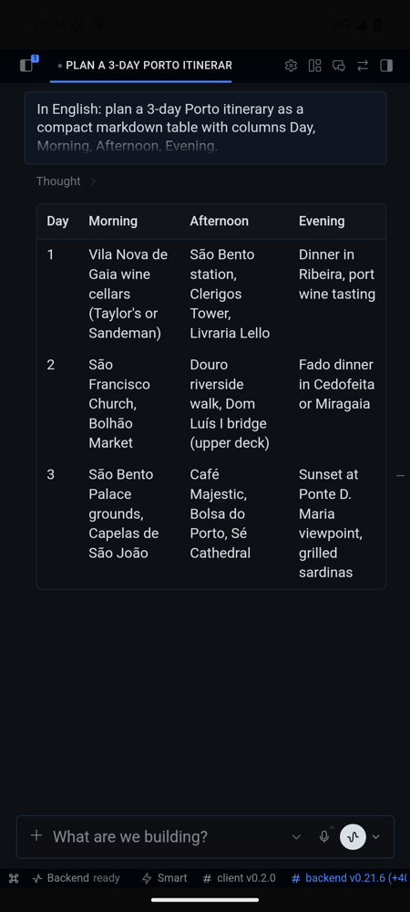
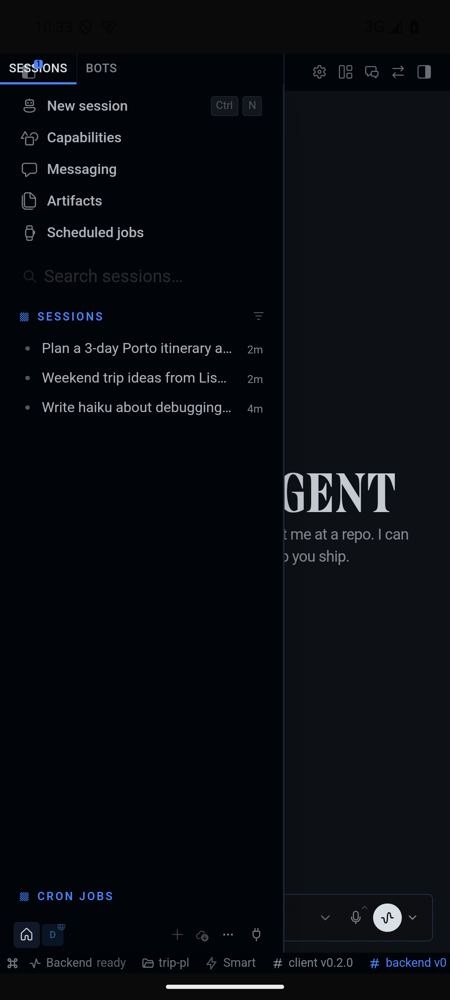
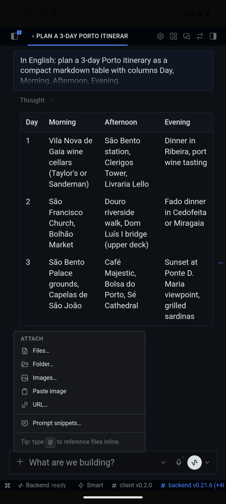
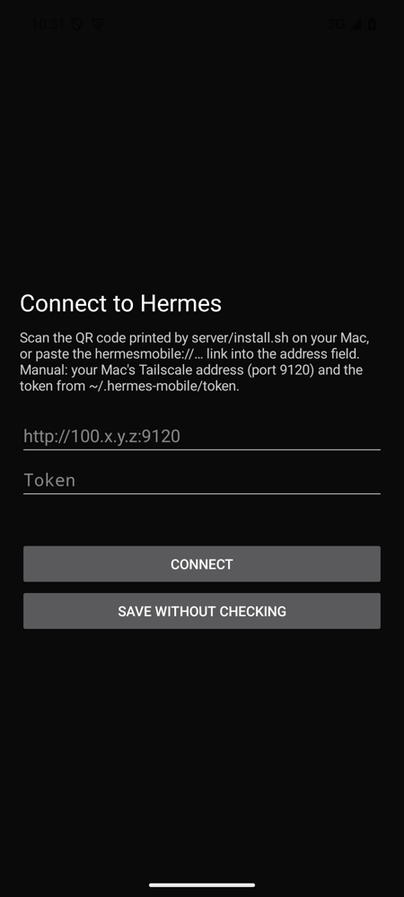

# Hermes Mobile

> **Unofficial.** Hermes Mobile is an independent community project. It is not affiliated with, endorsed by, or
> supported by Nous Research. "Hermes" and the Hermes logo belong to their respective owners.

An Android app for your [Hermes Agent](https://github.com/NousResearch/hermes-agent) running on a Mac. Over
[Tailscale](https://tailscale.com), you get the full Hermes Desktop experience on your phone: every chat, live
streaming, file attachments, voice dictation, model and profile switching, slash commands, approvals, and
notifications.

The app reuses the **Hermes Desktop renderer**, the same React UI the Mac app runs, inside a thin native Android
shell. As a result, almost every desktop feature works out of the box and stays in step with your Hermes version.
The Mac-local file system, terminal, and git panes are not available on mobile.

<p>
  
  
  
  
</p>

```
Android app ──Tailscale──▶ Mac :9120 proxy ──▶ Hermes Desktop's own backend (live, shared with the Mac app)
                                         └──▶ fallback: standalone `hermes serve` on 127.0.0.1:9119
```

## Requirements

- macOS with Hermes installed (`hermes` on PATH) and, ideally, Hermes Desktop running
- Node.js 18+ on the Mac
- Tailscale on both the Mac and the phone, in the same tailnet
- Android 10+ (API 29)
- To build: JDK 17+, Android SDK (platform 36), Gradle 9

## 1. Mac side

```bash
git clone <this repo> hermes-mobile && cd hermes-mobile
./server/install.sh          # brew install qrencode first if you want a QR code in the terminal
```

This script:

- creates `~/.hermes-mobile/` with a random access token (`~/.hermes-mobile/token`, mode 600) and logs;
- installs two launchd agents, `io.github.hermesmobile.proxy` and `io.github.hermesmobile.serve`;
- prints a `hermesmobile://connect?...` link (and a QR code if you have qrencode) for the phone.

The proxy listens **only** on loopback and your Tailscale addresses. Every request must carry the token. When Hermes
Desktop is running, the proxy talks to Desktop's own backend, so the phone and the Mac see the same live turns. When
Desktop is closed, it uses the standalone fallback.

To remove everything: `./server/uninstall.sh` (add `--purge` to delete the token too).

## 2. Build the APK

The build bundles the Hermes Desktop renderer from your Hermes install:

```bash
cd app
gradle assembleRelease                      # reads ~/.hermes/hermes-agent/apps/desktop/dist
# or: gradle assembleRelease -PhermesDesktopDist=/path/to/hermes-agent/apps/desktop/dist
```

The APK lands in `app/app/build/outputs/apk/release/`. Install it with `adb install`, or share the file.
Release builds are signed with the local debug key, which is fine for sideloading. Configure your own keystore if you
plan to distribute more widely.

Rebuild the APK after a major Hermes update so the bundled UI matches the backend version.

## 3. Connect the phone

Scan the QR code with the phone camera, open the `hermesmobile://` link, or paste the link into the app's setup screen.
To reopen setup later, long-press the app icon and choose **Connection**.

## Troubleshooting

- **Phone can't connect away from home, but works on the same Wi-Fi.** Another VPN on the Mac is probably
  capturing Tailscale's traffic. Run `tailscale netcheck`; `UDP: false` or no nearest DERP means it can't reach
  Tailscale's relays. Exclude `100.64.0.0/10`, `fd7a:115c:a1e0::/48` and `*.tailscale.com` from that VPN's tunnel.
- **Backend stays "offline".** Check `~/.hermes-mobile/logs/proxy.log`. It shows which backend the proxy uses
  and which addresses it listens on.

## How it works

- `app/`: Kotlin shell. Inside the app, it runs a loopback HTTP server on `127.0.0.1:47219` that serves the
  renderer from the APK and pipes `/api/*` and the WebSocket to the Mac. The loopback origin is a *secure context*,
  which is what lets the microphone, clipboard, and other web APIs work over plain `http://` on the tailnet. The
  native shell also handles the file picker, downloads, notifications, the back button, and edge-to-edge insets.
- `shim/shim.js`: implements the Electron preload bridge (`window.hermesDesktop`) on top of the remote backend,
  plus touch fixes for desktop-only menus.
- `server/`: the Mac-side proxy and the launchd installer.

## Security notes

- The token is a full-access credential to your Hermes. Anyone on your tailnet who has it can drive your agent.
- The traffic is plain HTTP inside Tailscale's WireGuard tunnel. Don't expose port 9120 outside the tailnet.

## License

MIT; see [LICENSE](LICENSE) and [NOTICE](NOTICE). The app icon and the bundled Hermes Desktop renderer come from
[Hermes Agent](https://github.com/NousResearch/hermes-agent) (MIT, © Nous Research).
